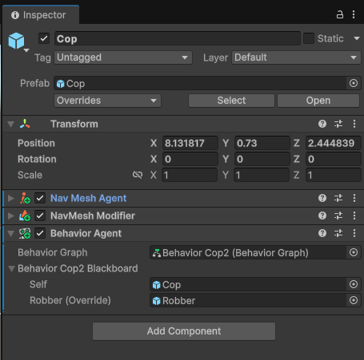
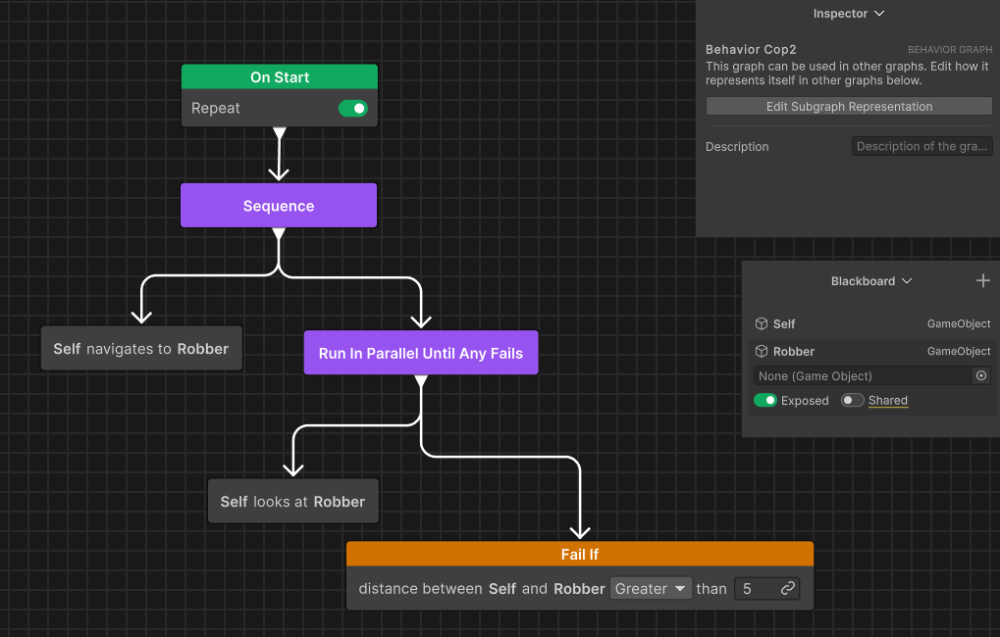

# Behavior Trees

**Comentaris previs**:

El disseny d'arbres de comportament és una tasca no trivial. Us recomano que mireu l'article [Behavior trees for AI: How they work](https://www.gamedeveloper.com/programming/behavior-trees-for-ai-how-they-work) per començar.

Unity conté un paquet *Unity Behavior* per treballar amb *behavior trees*. Necessita instal·lació externa. És el que farem servir.

**Instal·lació en el projecte del Unity Behavior**:

Per poder utilitzar aquest component s'ha d'instal·lar previament. Aneu al menú, *Window - Package Manager*, cliqueu al **+** ubicat a la part de dalt a l'esquerra i *Add package by name..*. Introduiu el nom **com.unity.behavior**. Un cop instal·lat, podeu tancar el *Package Manager*.

**Exemple**:

En aquest document mostrarem com funcionen els *behavior trees* en Unity a partir d'un exemple: un policia anirà (*seek*) cap a un lladre quan estigui lluny d'ell i l'anirà "mirant/vigilant" quan estigui a prop.

Utilitzarem el *Behavior Agent* com a component per executar els *behavior trees*:

||
|:--:| 
| Component *Behavior Agent* |

Tenim la *Blackboard* com a mecanisme de compartició de variables entre els *behavior trees* i l'entorn.

A continuació teniu l'implementació dels *behavior trees*:

||
|:--:| 
| Behavior Tree |

L'*Acció* `Self moves to robber` té les propietats (al *Node Inspector*):

| propietat | valor |
|:--|:--| 
| Agent | Self |
| Target | robber |
| Speed | 1 |
| Distance Threshold | 5 |

Les implementacions de *Behavior Trees* solen tenir els components bàsics i facilitat per implementar accions i condicions. Si feu un "Inspect Script" d'una condició o acció podeu veure com estan implementades. 

## Implementació

- [Behavior Trees](demos/bts.unitypackage)

## Referències

- [Unity Behavior](https://docs.unity3d.com/Packages/com.unity.behavior@1.0/manual/index.html)

- Chris Simpson. [Behavior trees for AI: How they work](https://www.gamedeveloper.com/programming/behavior-trees-for-ai-how-they-work). Game Developer, 2014.

- Asset [Easy Primitive People](https://assetstore.unity.com/packages/3d/characters/easy-primitive-people-161846)

- Asset [Five Seamless Tileable Ground Textures](https://assetstore.unity.com/packages/2d/textures-materials/floors/five-seamless-tileable-ground-textures-57060)

- Asset [LowPoly Trees and Rocks](https://assetstore.unity.com/packages/3d/vegetation/lowpoly-trees-and-rocks-88376)

