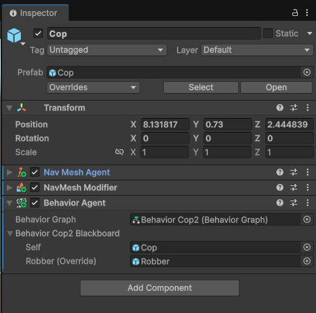
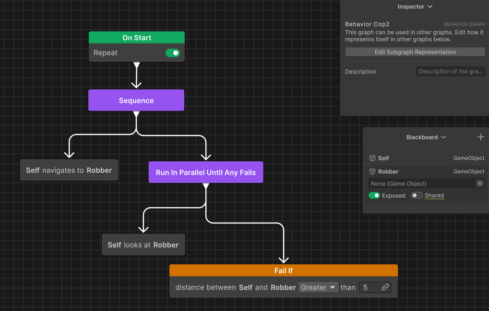

# Behavior Trees

**Comentarios previos**:

El diseño de árboles de comportamiento es una tarea no trivial. Os recomiendo que leais el articulo [Behavior trees for AI: How they work](https://www.gamedeveloper.com/programming/behavior-trees-for-ai-how-they-work) para empezar.

Unity contiene un paquete *Unity Behavior* para trabajar con *behavior trees*. Necesita instalación externa. Es el que utilizaremos.

**Instalación en el proyecto del Unity Behavior**:

Para poder utilizar este componente se tiene que instalar previamente. Ir al menú, *Window - Package Manager*, clicad en lel **+** ubicado en la parte superior izquierda y *Add package by name..*. Introducir el nombre **com.unity.behavior**. Una vez instalado, podéis cerrar el *Package Manager*.

**Ejemplo**:

En este documento mostraremos como funcionan los *behavior trees* en Unity a partir de un ejemplo: un policia irá (*seek*) hacia un ladrón cuando esté lejos de él y ira "mirándolo/vigilándolo" cuando esté cerca.

Utilizaremos el *Behavior Agent* como componente para ejecutar los *behavior trees*:

||
|:--:| 
| Componente *Behavior Agent* |

Tenemos la *Blackboard* como mecanismo de compartición de variables entre los *behavior trees* y el entorno.

A continuación tenéis la implementación de los *behavior trees*:

||
|:--:| 
| Behavior Tree |

La *Acción* `Self moves to robber` tiene las propiedades (en el *Node Inspector*):

| propiedad | valor |
|:--|:--| 
| Agent | Self |
| Target | robber |
| Speed | 1 |
| Distance Threshold | 5 |

Las implementaciones de *Behavior Trees* suelen tener los componentes básicos y facilidad para implementar acciones y condiciones. Si hacéis "Inspect Script" de una acción o condición podéis ver como están implementadas.

## Implementación

- [Behavior Trees](demos/bts.unitypackage)

## Referencias

- [Unity Behavior](https://docs.unity3d.com/Packages/com.unity.behavior@1.0/manual/index.html)

- Chris Simpson. [Behavior trees for AI: How they work](https://www.gamedeveloper.com/programming/behavior-trees-for-ai-how-they-work). Game Developer, 2014.

- Asset [Easy Primitive People](https://assetstore.unity.com/packages/3d/characters/easy-primitive-people-161846)

- Asset [Five Seamless Tileable Ground Textures](https://assetstore.unity.com/packages/2d/textures-materials/floors/five-seamless-tileable-ground-textures-57060)

- Asset [LowPoly Trees and Rocks](https://assetstore.unity.com/packages/3d/vegetation/lowpoly-trees-and-rocks-88376)

